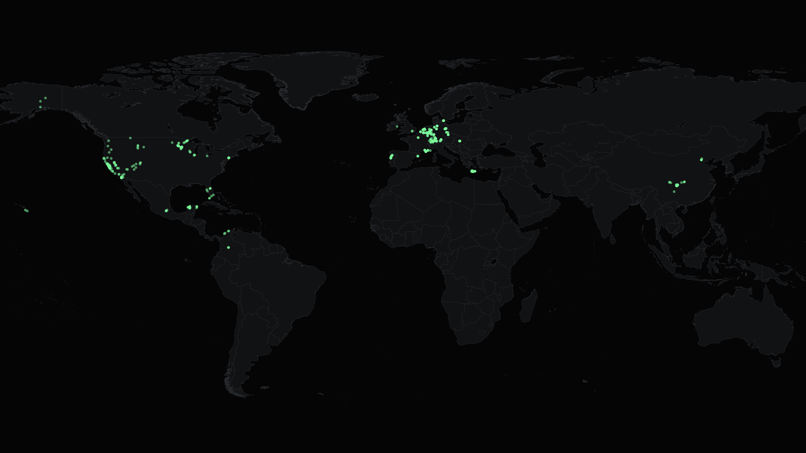

# gmaps_pin_plotter



This is a script to plot google maps pins using matplotlib.

World map data is from [naturalearthdata](https://www.naturalearthdata.com/downloads/10m-cultural-vectors/10m-admin-0-countries/).

Extract the pin data from [google takeout](https://takeout.google.com) under:

1. "Maps (your places)" - contains pins of only the "star" type.
2. "Saved" - contains other categories of pins (not currently plotted).
## Fetching the data automatically

```
python fetch_takeout.py
```

This opens Chrome, requests a Takeout export of only "Maps (your places)", waits for Google to build it, downloads it, and writes `Takeout/Maps (your places)/Saved Places.json`. The previous file is kept as `Saved Places.json.bak`. Chrome uses its own profile in `.chrome-takeout-profile/`, so you sign in on the first run and later runs reuse that session. Google may still ask you to re-enter your password before the download.

- `--skip-create` downloads the newest export already listed at takeout.google.com/manage
- `--zip path/to/takeout.zip` only extracts from an archive you already downloaded
